# Sifer

Sifer is cryptography you can see inside. Pick AES, give it a key and a line of
text, and watch the sixteen bytes of the state change round by round, each changed byte lit.
Open SubBytes and one byte is inverted in GF(2⁸) and pushed through the affine map bit by
bit. Flip one bit of the plaintext and a heat map shows the difference spreading until half
of the 128 bits differ. Under every picture a sentence says what that step did, with the
actual values.

I have taught cryptography for years, and students meet it as black boxes. "AES encrypts."
"RSA is hard." "Use GCM." They can quote the formulas and call a library, but what happens
inside stays out of sight: why one flipped bit changes half the ciphertext, what MixColumns
does to a column, why a reused nonce gives everything away, how a 2048-bit exponentiation
finishes at all. On a whiteboard I can work one round of a toy cipher by hand; the real one
is a few slides of hex nobody reads. Sifer opens every algorithm up. Every intermediate value
is drawn, in hex, as bits that light up, or as a picture, and data flows along wires from
block to block. The toy version sits beside the real one, so the 16-bit Mini-AES you can
follow by hand and AES-128 are seen to be the same machine. And every engine reproduces the
published test vectors of its standard, so what you see is what the standard says.

The course is defensive throughout. Where a scheme can be misused, the weakness is shown
together with the rule that prevents it, and students do not carry out attacks on real
schemes. Only the classical ciphers, the Enigma and its Bombe, toy stream and block ciphers,
the two-time pad and collisions on cut-down hashes are broken outright, because breaking
them is how the ideas are learned.

Live at https://sifer.jyotiprakash.org

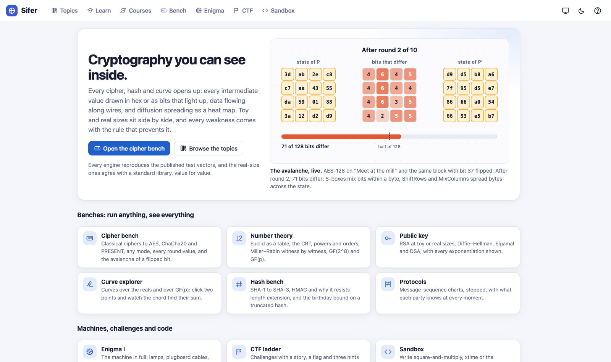

## What it is

Sifer is one HTML file. There is nothing to install and nothing is sent anywhere; your keys,
answers and progress are kept in the browser. Under the page are engines written for it:
classical ciphers and how they are solved, Enigma I and a Bombe, number theory and finite fields,
stream ciphers, DES, AES, PRESENT and two toy ciphers, the modes of operation, RSA,
Diffie–Hellman and the discrete logarithm, elliptic curves, signatures, the SHA-1, SHA-2 and
SHA-3 families, MACs, key derivation and protocols, ML-KEM and the other post-quantum
schemes, and a simulator of power traces and timing. Real sizes use BigInt, and the slow
work (an RSA-2048 key, a Bombe run, correlation over thousands of traces) runs in a Web
Worker or in chunks, so the page does not freeze. Every operation a student can watch
returns a trace of its steps, and every picture is drawn from that trace.

There are 227 topics in 76 families, in fifteen parts, which follow the usual order of an
applied cryptography course:

1. **Classical ciphers and cryptanalysis** (26 topics in 7 families): shift, affine and
   substitution ciphers, brute force and Kerckhoffs' principle, frequency analysis as a game
   and by hill climbing, Vigenère broken in three moves (Kasiski, the index of coincidence,
   a shift per column), transposition and Playfair, the one-time pad, and the Enigma: a key
   press through the machine, the double step, the plugboard, Rejewski's cycles and the
   Bombe.
2. **Modular arithmetic and number theory** (21 in 7): the modular clock, the ring Z_n and
   inverses, Euclid and extended Euclid as tables that fill in, Euler's φ, Fermat and Euler
   as cycles of powers, Fermat's test, Carmichael numbers and Miller–Rabin, groups and
   Lagrange, the Chinese remainder theorem as two clocks, and GF(p), GF(2^m) and GF(2⁸).
3. **Stream ciphers** (13 in 4): perfect secrecy and the two-time pad, randomness, LFSRs,
   their period, Berlekamp–Massey, the Geffe generator and its correlation attack, Trivium,
   and Salsa20, ChaCha20 and XChaCha20.
4. **DES and the Feistel network** (15 in 4): the Feistel principle, DES end to end (IP, the
   f-function, the key schedule, decryption, the avalanche), weak keys, the cost of a key
   search, double DES met in the middle, 3DES and DESX, differential and linear attacks on a
   toy SPN, and PRESENT.
5. **AES** (14 in 6): the state, SubBytes, the S-box, ShiftRows, MixColumns, AddRoundKey,
   the key schedules, a whole encryption and decryption, the avalanche, Mini-AES by hand,
   T-tables and why they leak, and key length.
6. **Modes of operation** (12 in 4): ECB, CBC, CFB, OFB, CTR and XTS as data flow, GCM,
   padding and ciphertext stealing, the limits of key length and block size, and the rules
   of correct use: encryption is not integrity, a nonce must never repeat, and the order of
   encrypting and authenticating.
7. **Public-key cryptography** (5 in 2): the key-distribution problem, trapdoor functions,
   what public keys are for, security levels and hybrid encryption.
8. **RSA** (19 in 5): key generation, encryption and why decryption works,
   square-and-multiply, the Montgomery ladder and Montgomery multiplication, the CRT, small
   exponents, textbook malleability, OAEP and PSS, why each rule for keys exists (a small e,
   a common modulus, one message to three people, a small d, close primes, shared primes, a
   fault in CRT signing), each with its defence, and toy keys beside real ones.
9. **The discrete logarithm problem** (12 in 4): the problem, Diffie–Hellman as mixing paint
   and with numbers, the man in the middle, Elgamal, baby-step giant-step, Pollard's rho,
   Pohlig–Hellman, index calculus, small subgroups and why received values are checked,
   Elgamal, DSA and Schnorr signatures, and why a DSA nonce must never repeat.
10. **Elliptic curves** (21 in 7): curves over the reals, the group law over GF(p), the
    point at infinity, the order of a point, Hasse's bound, double-and-add, the Montgomery
    ladder, wNAF, Jacobian coordinates, ECDH, X25519, three forms of one curve, P-256 and
    Curve25519, point compression, why the logarithm on a curve is hard (baby-step
    giant-step, Pollard's rho, Pohlig–Hellman, and the anomalous curves to avoid), and why
    received points and the twist must be checked.
11. **Digital signatures** (10 in 6): what a signature gives that a MAC does not, RSA
    signatures and PSS, Elgamal, DSA and Schnorr, ECDSA with an RFC 6979 nonce, Ed25519, the
    rules a nonce must keep (fresh, secret, uniform), and choosing a scheme.
12. **Hash functions** (14 in 5): preimage, second preimage and collision as games, the
    birthday paradox, Merkle–Damgård, the SHA-256 message schedule and compression function,
    SHA-1, MD5 and how hashes fall, the sponge, Keccak's θ, ρ, π, χ and ι, SHAKE, and labs
    on birthday and rho collisions and Joux multicollisions on cut-down digests, and length
    extension: why hash(secret ‖ message) is no MAC, and how HMAC and SHA-3 avoid it.
13. **MACs, key establishment and protocols** (15 in 5): the forgery game, HMAC, CBC-MAC and
    why it needs one fixed length, CMAC, GMAC, Poly1305, ChaCha20-Poly1305, HKDF,
    Needham–Schroeder, its replay and its repair, Kerberos, Diffie–Hellman with and without
    authentication, certificates, and the TLS 1.3 handshake and key schedule.
14. **Post-quantum cryptography** (18 in 6): Grover and Shor, security levels before and
    after, lattices, Gram–Schmidt, Lagrange–Gauss reduction, Babai's rounding, LWE, ML-KEM,
    the NTT, the noise budget and implicit rejection, Lamport, Winternitz, Merkle trees and
    SLH-DSA, McEliece, and a toy lattice signature with rejection sampling.
15. **Side channels and implementation** (12 in 4), the part on secure implementation: how
    correct code can still leak, and the defence for each channel. Power traces, the Hamming
    weight and distance models, SPA, DPA, CPA, how many traces, masking, cache timing on
    T-table AES, a MAC check that leaks through the clock, constant-time code beside leaky
    code, a fault on RSA-CRT, and a map of the defences.

Besides the topics there are 162 lessons, 497 exercises, 15 CTF challenges, 11 sandbox
tasks, 15 guided tours and 15 courses.

## Watching a topic

A topic has inputs, a few presets, a stage, and controls to play, pause, step either way,
scrub and change the speed. Each step is narrated with the values it uses. Beside the stage
the definition panel shows the formal rule with the line in use lit, and a list of every
step to jump to; counters keep a tally where it matters (rounds done, squarings and
multiplications, traces used). Before key moments the player can stop and ask what comes
next, and each topic ends with a quiz. A topic with its input can be shared as a link.

Inputs are yours to choose: your own plaintext and key, a FIPS 197 example, a byte with its
top bit set. Here SubBytes follows one byte of a state: 1c is inverted to ff in GF(2⁸), and
the affine map computes each output bit as the XOR of five bits of ff and a bit of 63.

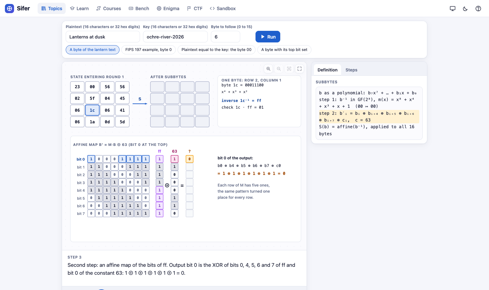

The avalanche is drawn as a heat map, round by round. One plaintext bit goes in; after
round 2 every byte differs; after round 10 the two ciphertexts differ in 71 of 128 bits.

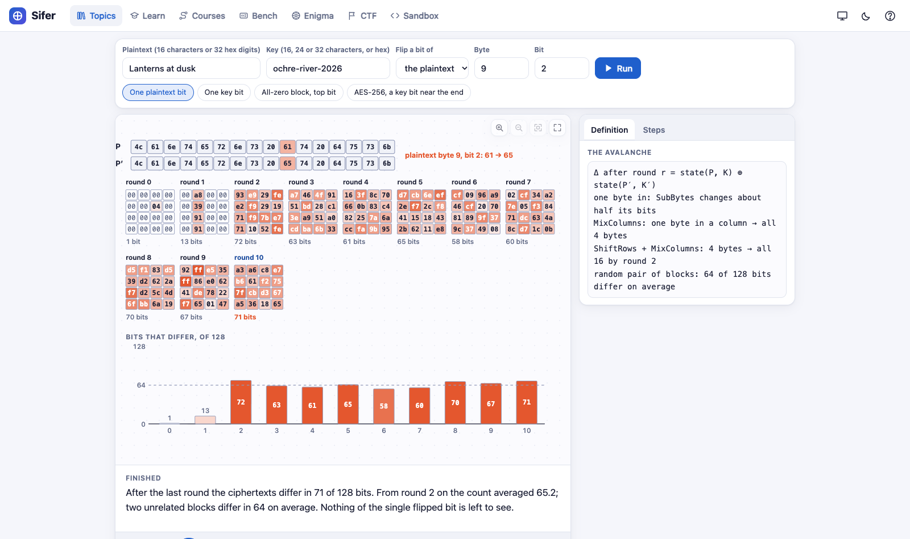

A DES round opens into its f-function: E, the round key, the eight S-boxes and P, each in
bits, with the S-box table and the row and column a six-bit input picks.

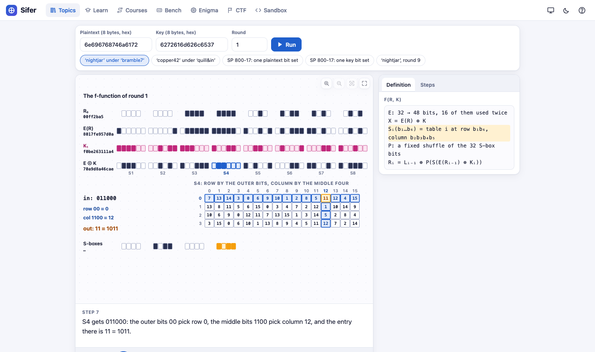

ChaCha20's quarter-round is drawn as the wiring of its adds, XORs and rotations, with the
four words beside it in bits, the bits each step changed lit.

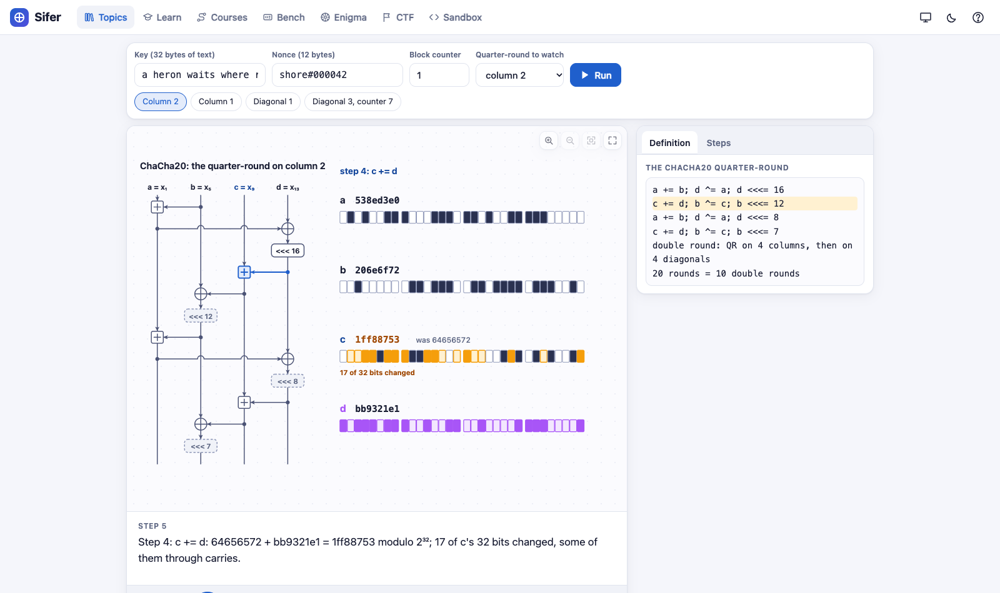

The modes are data flow: blocks, wires and XORs, filled in block by block.

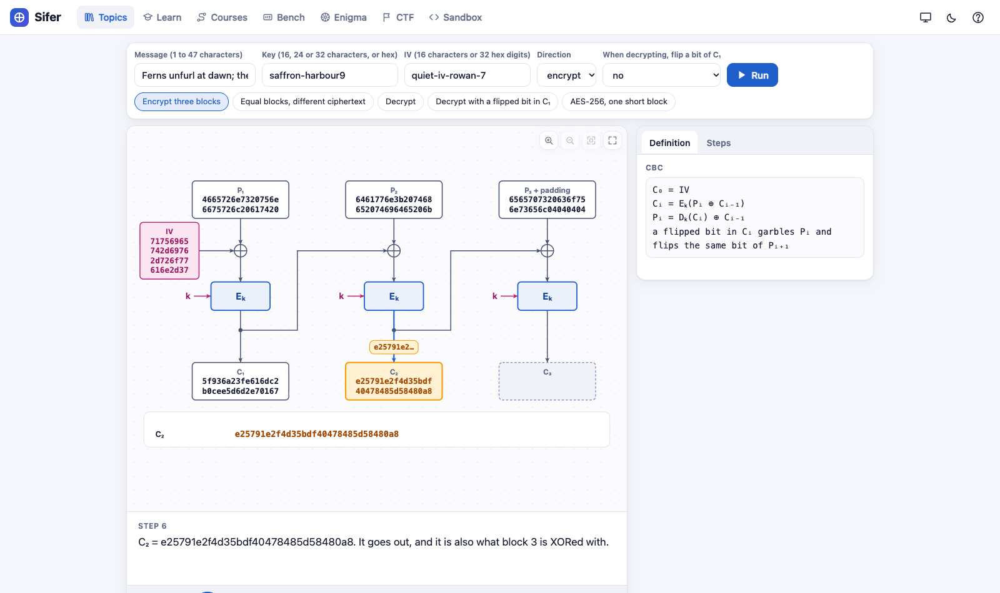

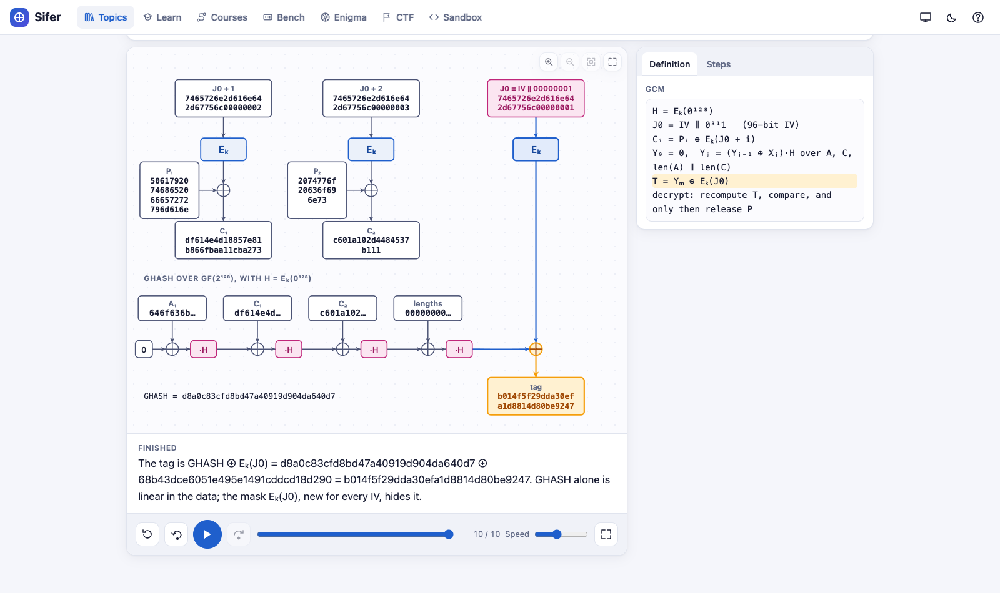

SHA-256 shows its eight registers and how T1 and T2 are formed in each of the 64 rounds;
Keccak shows its 1600-bit state as five planes of lanes, with the bits one step reads and
writes, and the same state as a cube.

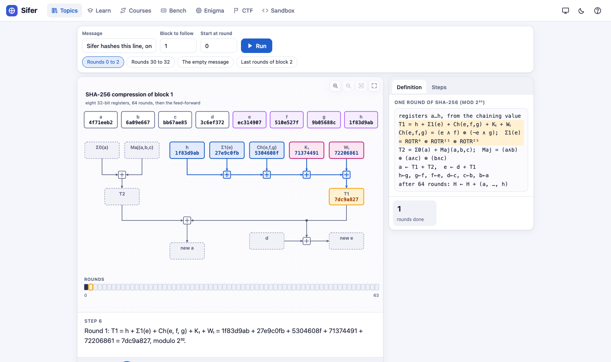

![Keccak θ: the state as five rows of 64-bit lanes, the column parities C[x], D[x] = C[x−1] ⊕ rot(C[x+1], 1), the column (1, 29) being flipped in orange, and the state drawn as a cube with that column picked out](docs/images/keccak.png)

Elliptic curves are drawn over the reals, where the chord through P and Q meets the curve a
third time, and over GF(p), where the same line wraps round the field.

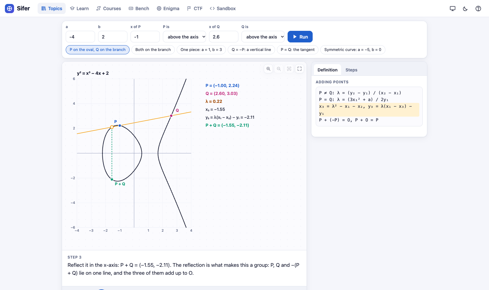

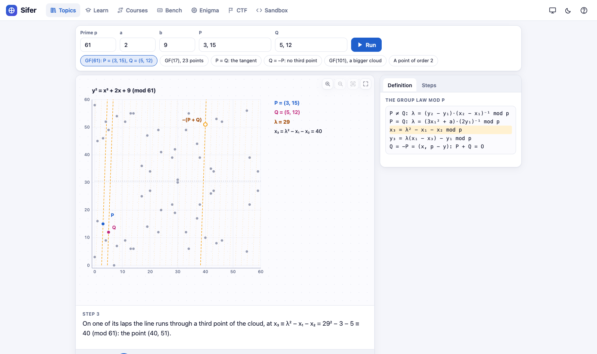

Toy and real sizes use the same topics. Square-and-multiply runs here on a 2048-bit private
exponent, from the left and from the right, with the bits of d as a grid and each 617-digit
value shown by its ends.

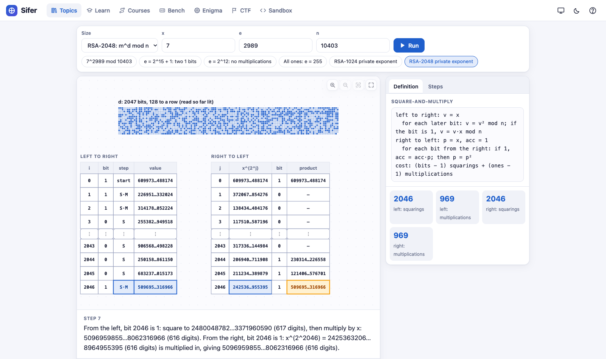

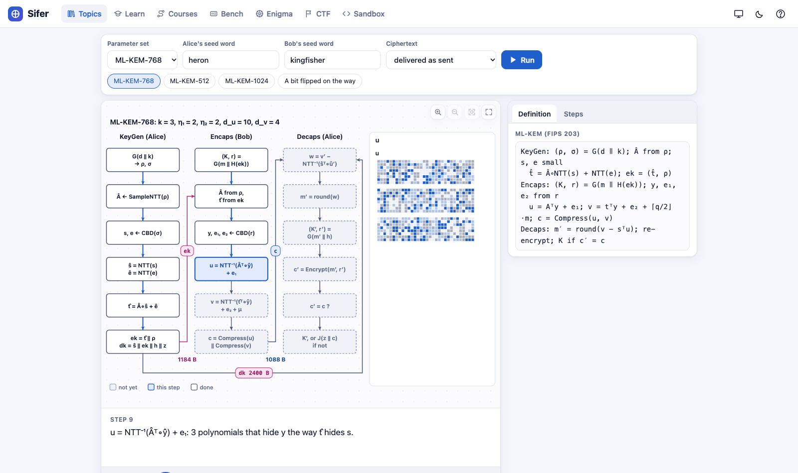

Part 15, secure implementation, is about defence: it shows how little an implementation has
to leak. In simulated power traces of AES, the correlation for the true key byte rises out
of the noise as the traces add up, which is the leak that masking, shuffling and
constant-time code remove.

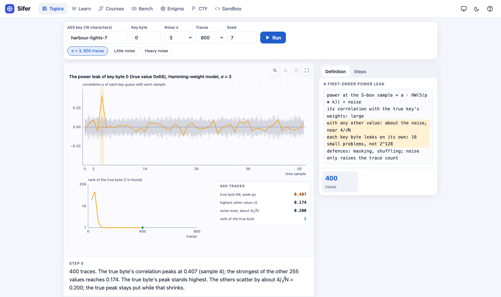

Protocols are message-sequence charts, with a box per party of what it knows at each moment,
keys in rose.

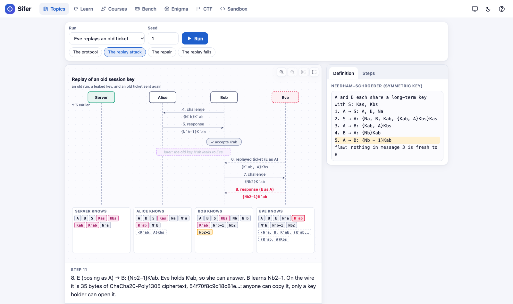

## The benches

The **benches** run anything, on your input, with everything shown. There are six.

The **cipher bench** has the classical ciphers, AES-128, -192 and -256, DES, 3DES, PRESENT,
Mini-AES, the toy SPN, ChaCha20, Salsa20 and Trivium, and the modes ECB, CBC, CFB, OFB, CTR,
CFB-8, CBC with ciphertext stealing, GCM and XTS. Key, IV and input are given as text, hex
or a file. It shows the output, the ladder of round states with the bytes each round changed
lit and the round key in rose, the steps inside any round, the mode drawn block by block,
the avalanche of one flipped bit of the plaintext, the key or the IV, and the engine's own
narration. Mini-AES can sit beside AES-128, and the toy SPN beside PRESENT. Its second tab,
**Labs and defences**, has hands-on labs on toy and classical ciphers only: the two-time
pad, meet in the middle on a cut-down double DES, the toy SPN, the correlation attack on
Geffe, and Berlekamp–Massey. For the real modes it has defence cards instead (CBC padding
errors, ECB, malleable CBC and CTR, reused CTR and GCM nonces), each giving the rules and
linking to the topic that shows why.


The **number-theory bench** has Euclid and extended Euclid as tables, the CRT, powers bit
by bit, the order of an element, Fermat and Miller–Rabin witness by witness, and arithmetic
in GF(p) and GF(2^m), at any size. The **public-key bench** has RSA with primes you pick or
a real key searched for in a worker, candidate by candidate, textbook and OAEP encryption,
decryption directly and by the CRT, textbook and PSS signatures, and Diffie–Hellman,
Elgamal, DSA, Schnorr, ECDH, X25519, ECDSA and Ed25519. The **curve explorer** places P and
Q with a click on a curve over the reals and draws the chord, and over GF(p) builds k·P by
double-and-add or the Montgomery ladder and counts the points inside Hasse's bound. The
**hash bench** hashes text, hex or a file with the Merkle–Damgård chain and the registers of
every round (or the sponge's lanes), runs HMAC, has a defence card on length extension
(which hashes expose their whole state, and why a keyed tag must be HMAC or KMAC), and runs
the birthday attack on a hash cut down to a few bits, with a counter. The **protocol
bench** steps through Diffie–Hellman, the man in the middle, signed Diffie–Hellman with and
without the attacker, Needham–Schroeder, its replay and its repair, Kerberos-style tickets,
a TLS 1.3 handshake and certificate chains (a valid chain, a forged certificate, a self-made
root, an expired or revoked certificate, the wrong host, a server playing CA), with what
each party knows at every moment.

A bench keeps its inputs in the browser and can be shared as a link that opens the same
setup.

## The Enigma wing

The **Enigma** page has one Enigma I shared by five views. The **machine** is drawn in full:
the wooden case, the three rotor windows with thumbwheels, the lampboard, the keyboard and
the plugboard with cables you drag. Type on your own keyboard or press the keys; a key held
down keeps its lamp lit. The **inside** view opens the machine so the pawls and notches move
and the double step can be seen. The **signal path** traces the current from the key
through the plugboard, the three rotors, the reflector and back to a lamp. The **key sheet**
gives a month of daily keys for a practice net, made from a seed, and any day can be set
on the machine. Rotors, reflector, rings,
start and cables are set in a card beside the machine, and a message can be typed out at a
readable pace onto a tape.

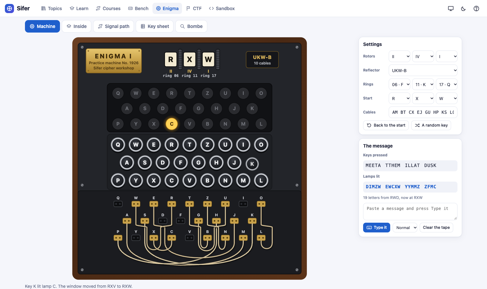

The **Bombe** breaks a message. You give an intercept and a crib; the page shows where the
crib can sit (no letter encrypts to itself), draws the menu the crib makes with its loops
lit, and runs the drums through all 60 rotor orders and 17,576 positions each in a worker,
either at full speed or slowly to watch. Each stop is checked by deducing the plugboard,
and the one that survives gives the key, the plaintext and a button that loads it into the
machine. Rejewski's characteristic cycles are a lesson in permutations and conjugacy, which
ties back to part 2.


Sifer has Enigma I and its Bombe only. The full collection of machines (M3, M4, the Abwehr G,
the Railway and more) is in my Enigma app for Android.

## The sandbox and the CTF ladder

The **sandbox** is where students write the pieces themselves in JavaScript: there are 11
tasks and a scratch pad. The tasks are square-and-multiply, xtime, multiplication in GF(2⁸),
the AES S-box from scratch, the ChaCha quarter-round, extended Euclid, the modular inverse,
the CRT, double-and-add on a small curve, a round of Miller–Rabin and breaking a shift
cipher. Run tests sends the code to a sealed worker, with no page and no network and a time
limit, and checks it against test vectors; the first failing test is shown with its
arguments, what came back and what should have.

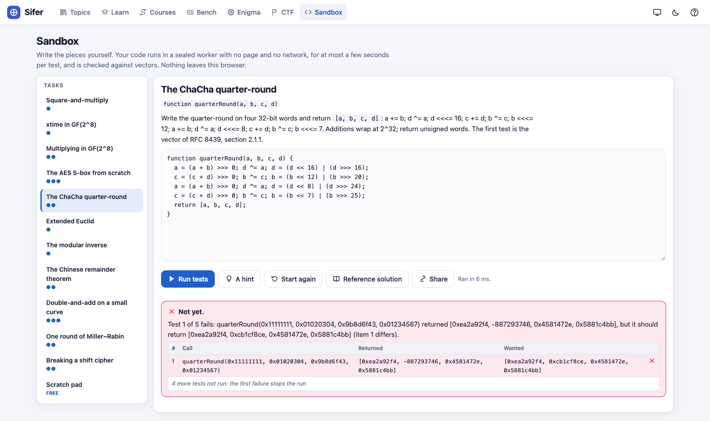

The **CTF ladder** has 15 challenges, all on classical ciphers, the Enigma, toy ciphers, a
pad or nonce used twice, number puzzles and cut-down hashes. Each is a short story of our
own with something broken in it (a pad used twice, a relay that encrypts twice with a toy
cipher, a keypad on a toy SPN that gives away its last round key, coat tags checked by 16
bits of a hash), its data, a flag to find and three hints that cost points. Progress and a
scoreboard are kept in the browser.

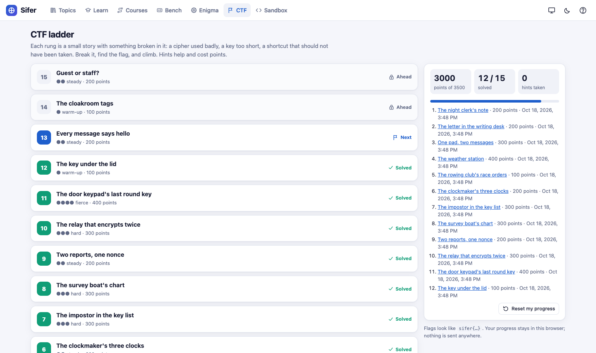

## Lessons, exercises, tours and courses

The **lessons** are short readings, a few to each chapter, with live topic players and
sample scenes inside them, predictions to answer, and links to the exercises that follow.

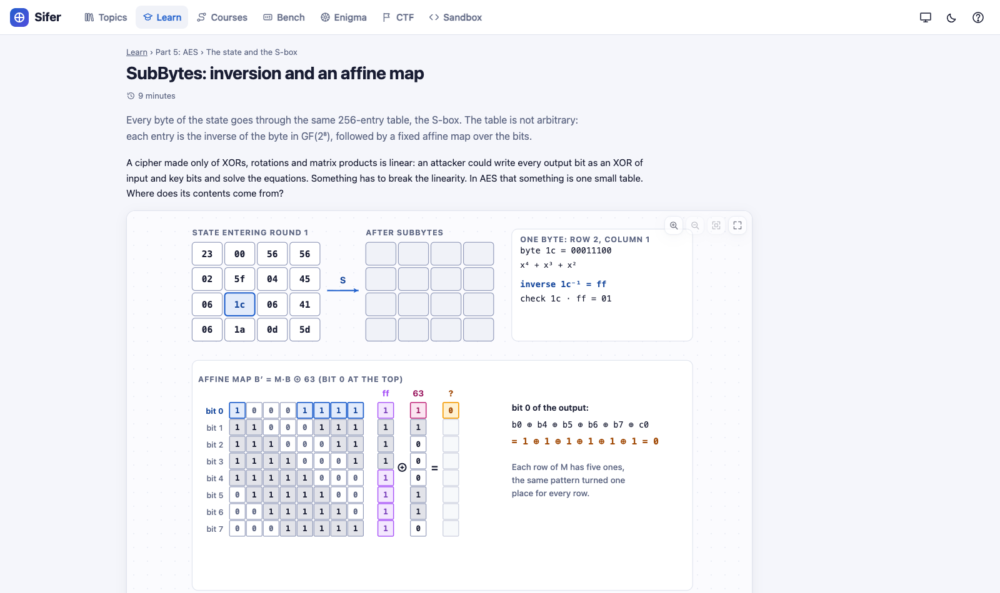

The **exercises** are checked by the page. The 497 exercises are of eight kinds: 135 ask for
a number, 131 are multiple choice, 75 fill in a table such as a state after a step, 52 ask
for bytes in hex, 49 ask for code, 26 are break-it tasks on classical and toy ciphers, pads
used twice and toy keys, 15 ask for a set and 14 for a string of letters or bits. Code runs
in the same sealed worker as the sandbox. Every exercise has three hints, the last a worked
answer.

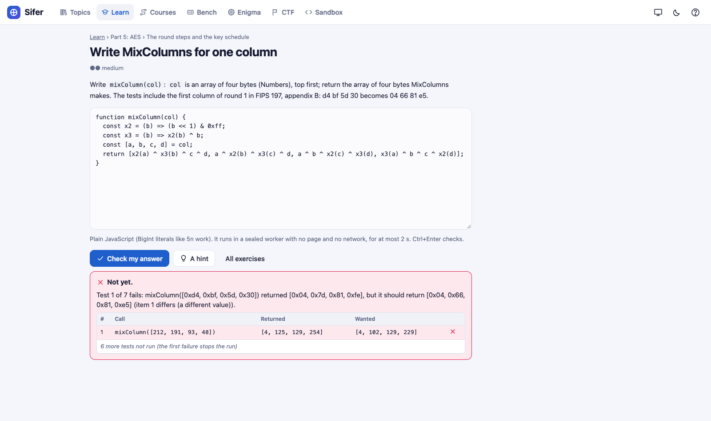

A **tour** walks through a part of the page a step at a time, lighting what to look at;
there is one for each of the fifteen parts. A **course** is an ordered path through the topics,
lessons and exercises of a part, each step with a word on what to look for, and a strip
above the page that says where you are. Progress through all of these is kept in the
browser.

## Phone, projector and themes

Every page works on a phone. The topic stage comes first with the narration under it, the
inputs follow, and the definition and steps open in a drawer from the bottom. The Enigma
case is cropped to its keys so they stay large enough to press. Projector mode (Shift+P)
makes the type larger and the lines stronger for a classroom, and moves the catalogue out of
the way of the picture. There is a light and a dark theme, or the one the system uses.

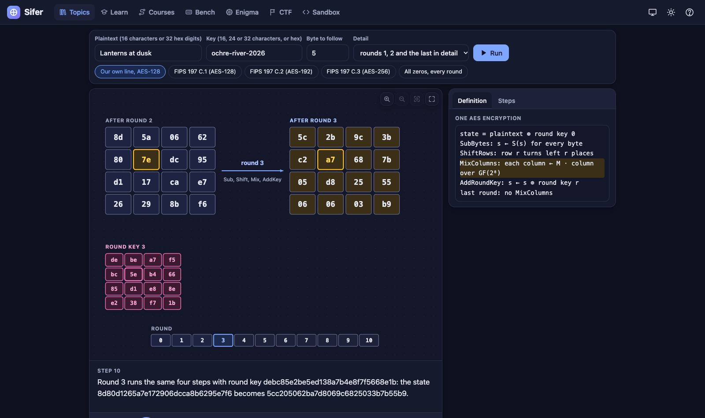

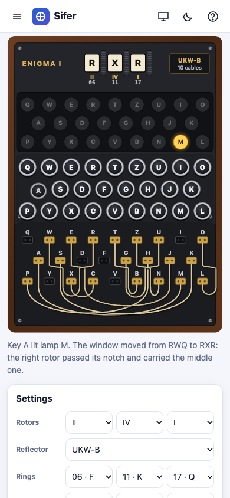

## Keyboard

| Key | What it does |
| --- | --- |
| Space | play or pause a topic |
| → ←, Home, End | next step, step back, first or last step |
| R | play again from the start |
| [ ] | slower, faster |
| F, Shift+F | fit the picture, the stage on the whole screen |
| + − | zoom in, out |
| B | a bigger stage |
| D | the definition or the steps (on a phone, the drawer) |
| P, Q | predictions on or off, the quiz |
| A … Z | press a key of the Enigma |
| Ctrl+Enter | run the sandbox tests, check a code exercise |
| T, Shift+P | light or dark, projector mode |
| Esc | close a dialog or the menu |
| ? | the list of keys |

## Running it locally

Sifer is the single file `index.html`. Open it from any web server:

```
python3 -m http.server 8000
```

and go to http://localhost:8000. To change it, edit the files under `src` and run

```
node build.mjs
```

which joins the sources listed in `src/manifest.json` into `index.html`. While working,
`node tools/devpage.mjs 8080` serves http://127.0.0.1:8080/dev.html, the same page with every
source file loaded on its own, so a change needs no build.

## Correctness

An engine that draws the wrong value teaches the wrong thing, so every engine is checked
against the published test vectors of its standard:

- FIPS 197 (AES-128, -192 and -256);
- NIST SP 800-38A (the modes) and SP 800-38D (GCM);
- FIPS 180-4 (SHA-1, SHA-256 and SHA-512);
- FIPS 202 (SHA-3 and SHAKE);
- FIPS 203 (ML-KEM, on a subset of the NIST ACVP vectors);
- RFC 7748 (X25519), RFC 8032 (Ed25519) and RFC 6979 (deterministic ECDSA on P-256);
- RFC 8439 (ChaCha20, Poly1305 and ChaCha20-Poly1305);
- RFC 4231 (HMAC with SHA-2) and RFC 5869 (HKDF);
- RFC 8448 (the key schedule of the example TLS 1.3 handshake).

Besides these, DES is checked against FIPS 81 and NIST SP 800-20, 3DES against SP 800-67,
XTS against IEEE 1619, MD5 against RFC 1321, HMAC-SHA-1 against RFC 2202, CMAC against
RFC 4493, PBKDF2 against RFC 6070, ciphertext stealing against RFC 3962, and PRESENT,
Trivium and Salsa20 against their published vectors. The Enigma is checked against two
well-known published Enigma I messages.

Then the engines are compared with Node's own `node:crypto` on thousands of random inputs:
AES at every key size, and in CBC, CTR, GCM and XTS; DES and 3DES; ChaCha20 and
ChaCha20-Poly1305; SHA-1, SHA-2, SHA-3, SHAKE and MD5; HMAC, HKDF and PBKDF2; RSA raw, with
OAEP and with PSS; Diffie–Hellman; ECDH and ECDSA on P-256 and secp256k1; X25519 and
Ed25519; DSA; Miller–Rabin against Node's prime check; and ML-KEM against Node's ML-KEM in
both directions. Every lab on a toy or classical cipher is run over several seeds and must
recover the secret planted in it, and every CTF challenge must accept its flag.

The narration is checked as well. For every topic, run with its default input, every preset
and random inputs, each value a sentence quotes is compared with a working-out done again
apart from the engines.

## Testing

`npm test`, which is `node tests/run.mjs`, runs every test in `tests`. Each can also run on
its own: the engine tests `node tests/aes.mjs`, and likewise `chacha`, `classic`, `des`,
`ecc`, `enigma`, `hash`, `hashmac`, `modes`, `modexp-ec`, `nt`, `pk2`, `pq`, `proto`, `sc`
and `sym`; and the narration checks `node tests/claims-p01.mjs` to `claims-p15.mjs`, one for
each part with topics.

`node tools/check-topics.mjs` runs every topic with its default input and every preset, and
checks that every frame draws, that the steps are narrated, that the predictions can be
answered, and that the topic has a quiz. `node tools/check-content.mjs` checks every
exercise (its solution passes its own checker and every one of its wrong answers fails, and
code runs under the sandbox's time limit), every lesson, every CTF challenge (its flag is
accepted and wrong ones are not), every sandbox task's reference solution, and every tour
and course step.

`node tools/check-diagrams.mjs` draws the sample scenes and every page and topic in both
themes and at desktop and phone sizes, and reports shapes that overlap, wires that cross or
run through blocks, labels that collide or are cut off, text smaller than 11 pixels, and
pages wider than the screen. `node tests/e2e/run.mjs` runs the end to end tests in headless
Chrome: the shell, every bench, the Enigma and the Bombe, the CTF ladder, the sandbox,
lessons and exercises. `node tools/readme-shots.mjs` makes the pictures in this file.

## Project layout

```
src/core      the engines: classical ciphers, Enigma and the Bombe, number theory and fields, stream and block
              ciphers, modes, RSA, discrete logarithms, curves, signatures, hashes, MACs, protocols,
              post-quantum schemes, side channels
src/stage     the stage that draws and animates a frame, and its drawing kits (byte and bit grids, data flow,
              registers, clocks, curve plots, lattices, message-sequence charts, trace plots ...)
src/topics    the topics, a file per family group: inputs, presets, frames, narration, predictions and quiz
src/content   the lessons, exercises, CTF challenges, tours and courses, a file per part
src/app       the page: topic player, benches, Enigma and Bombe, sandbox, CTF ladder, lessons, checkers, styles
src/demo      the sample scenes (index.html#demo)
tests         the engine tests, the narration checks, and the end to end tests in tests/e2e
tools         the Chrome driver, the topic, content and diagram checkers, screenshots
```

## License

Sifer is free software under the GNU General Public License, version 3 or later. See
`LICENSE` for the full text and `COPYRIGHT` for the notice.

Under section 7 of the license there are additional terms, written out in full in `NOTICE`.
Any copy, modification or derived work, including a hosted version, must keep the attribution
"Based on Sifer by Jyotiprakash Mishra (https://sifer.jyotiprakash.org)" in its source and
show it in its about screen or other legal notices. This applies to the program, the topics
with their narration and quizzes, the lessons, exercises and challenges, and screenshots or
recordings of the animations used as teaching material. A modified version must be marked as
changed and must not be presented as the original Sifer. The name Sifer is not licensed for
derived works.

The algorithms, the standards and their published test vectors belong to everyone. The keys,
messages, stories, challenges, examples, pictures and explanations in Sifer were made for it.

Copyright (C) 2026 Jyotiprakash Mishra
